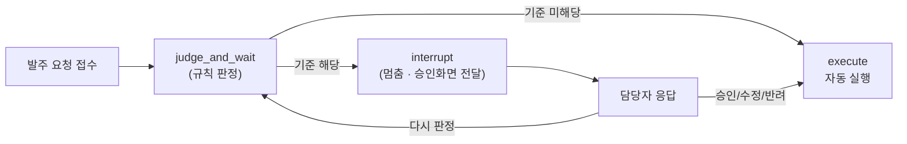

# REPORT — 재고 자동 발주 승인 (HITL)

## 1. 주제와 고른 이유

**주제**: 재고 자동 발주 승인 — 발주 요청을 규칙으로 자동 판정하고, 위험한 건만 사람이 승인한다.

**고른 이유**:
- 강의(N044) 5-2절 주제 예시 표에 있는 항목이라 채점 기준(HITL 파이프라인 + 승인 기준 2개 이상 + 웹 데모)과 정확히 맞아떨어진다.
- 승인 기준을 **숫자 비교만으로** 표현할 수 있어 판정에 LLM 호출이 필요 없다 — 이번 실습의 목표가 "판정 품질"이 아니라 "멈췄다 이어가는 구조(interrupt·resume·checkpointer·thread_id)" 자체를 익히는 것이므로, 판정 로직은 최대한 단순하게 두고 HITL 배관에 집중했다.
- 환불(강의 예제, 프로젝트 주제에서 제외)과 구조가 같아 강의 내용을 그대로 옮겨 적용하기 좋다.

## 2. 파이프라인 구조도



```
[텍스트 다이어그램]
발주 요청 접수 → judge_and_wait(규칙 판정)
                    ├─ 기준 미해당 → execute(자동 실행)
                    └─ 기준 해당  → interrupt(멈춤) → 담당자 응답
                                        ├─ 승인/수정후승인/반려 → execute
                                        └─ 다시 판정 → judge_and_wait로 되돌아감(그래프 엣지, 노드 안에서 반복 X)
```

## 3. 승인 기준과 그 이유

| 기준 | 규칙 | 이유 |
|---|---|---|
| ① 금액 | 발주액 > 1,000,000원이면 멈춤 | 되돌릴 수 없는 것: 큰돈이 거래처로 즉시 나간다 |
| ② 수량 | 수량 > 평소 주문량(avg_qty)의 2배면 멈춤 | 되돌릴 수 없는 것: 평소보다 훨씬 많은 재고가 한 번에 확정 발주된다 |

두 기준 모두 강의 3장의 "모호한 말 → 계산 가능한 규칙" 원칙을 그대로 따른 것이며, 코드에서 숫자 비교 두 줄로 표현된다(`graph.py`의 `_check` 함수).

## 4. 실행 결과 (합성 데이터 10건)

`data.py`의 P1~P10을 전체 판정 실행한 결과:

| 건 | 자동/대기 | 최종 처리 | 정답(예상) |
|---|---|---|---|
| P1 | 자동 실행 | auto_approved | 아니오 |
| P2 | 자동 실행 | auto_approved | 아니오 |
| P3 | 대기 → **승인** | approved | 예 |
| P4 | 대기 → **반려** | rejected | 예 |
| P5 | 대기 → **다시 판정(1회) → 승인** | approved | 예 |
| P6 | 자동 실행 | auto_approved | **예 (놓침)** |
| P7 | 자동 실행 | auto_approved | 아니오 |
| P8 | 대기 → **다시 판정(1회, 자동 해소)** | auto_approved | 예 |
| P9 | 대기 → **수정 후 승인**(500,000원/2개로 조정) | modified_approved | 예 |
| P10 | 자동 실행 | auto_approved | 아니오 |

**지표**
- 개입률: 5/10 (전체 요청 중 사람에게 넘어온 비율)
- 놓침(Miss): 2건 — P6, P8
- 헛멈춤(False Positive): 0건

**Miss 2건의 성격이 서로 다르다는 점이 이번 실습의 핵심 발견**:
- **P6**: 수량 30개가 평소(15개)의 정확히 2배(30)라서 `>` 조건(초과)에 걸리지 않은 **경계값 놓침**. 강의 3장의 경고("금액 기준 하나로는 R3만 잡히고 R5는 빠져나간다")와 같은 종류의 실수 — 기준식을 `>=`로 할지 `>`로 할지는 정책 결정이 필요하다는 걸 실측으로 확인했다.
- **P8**: 시스템은 정확히 잡아냈지만(대기 목록에 정상적으로 올라옴), 담당자가 "다시 판정"으로 수량 기준을 예외 적용해 자동승인으로 종결한 **사람이 승인한 예외** — 시스템 오류가 아니라 HITL의 "다시 판정" 기능이 의도대로 작동한 증거.

## 5. 데모 화면 설계

Streamlit 단일 화면 구성 (`app.py`):
1. **현황판** — 전체 10건의 상태를 표로 한눈에 (자동실행/대기중/각 결정)
2. **승인 대기 목록** — 대기 중인 건마다 카드 하나씩, 강의 4-2절 5요소를 그대로 표시:
   - 원본 요청, 핵심 수치(금액/수량), 멈춘 이유, 통과시키면 일어날 일
   - 버튼 4개: 승인 / 수정 후 승인(금액·수량 입력창) / 반려 / 다시 판정
3. **지표판** — 개입률·놓침·헛멈춤을 실시간 계산

(실행: `streamlit run app.py` → `http://localhost:8765` — 실제 화면 캡처는 로컬 실행 후 첨부)

## 6. 프로젝트 회고

- **가장 크게 배운 것**: "재개는 지점 재개가 아니라 단계 재실행"이라는 강의 원칙이 코드 레벨에서 정확히 무엇을 의미하는지 실습 중 버그로 직접 겪었다. 처음엔 "다시 판정" 로직을 while 루프로 노드 안에서 여러 번 `interrupt()`를 호출하도록 짰는데, 두 번째 `interrupt()` 호출이 예상과 다르게 동작했다(정상적으로 재중단되지 않음). 원인을 추적한 결과 상태 스키마(`OrderState` TypedDict)에 `ignore_qty_rule` 필드를 선언하지 않아, 그래프 스텝 사이에 그 값이 조용히 유실되고 있었다 — **LangGraph는 TypedDict에 선언된 필드만 스텝 간에 전달한다**는 것을 실측으로 확인했다. 이후 "다시 판정"을 노드 내부 루프 대신 조건부 엣지로 그 노드 자신에게 되돌리는 구조로 바꿔 한 노드당 `interrupt()` 호출을 최대 1회로 제한했더니 문제가 해결됐다.
- **검증 방법**: 헤드리스 Python 스크립트로 그래프 로직을 먼저 검증한 뒤 Streamlit UI에서 같은 시나리오를 클릭으로 재현 — 두 경로 모두에서 동일한 버그가 재현되고 동일하게 해결된 것을 확인했다.
- **아쉬운 점 / 다음에 해보고 싶은 것**: 이번엔 판정을 전부 규칙 기반으로 했지만, "사유가 애매한 요청"처럼 규칙만으로는 걸러지지 않는 경우(예: 발주 사유 텍스트 분석)에 LLM을 한 단계 추가하면 강의 4장의 "AI 판정 근거" 요소를 더 풍부하게 보여줄 수 있을 것 같다.
